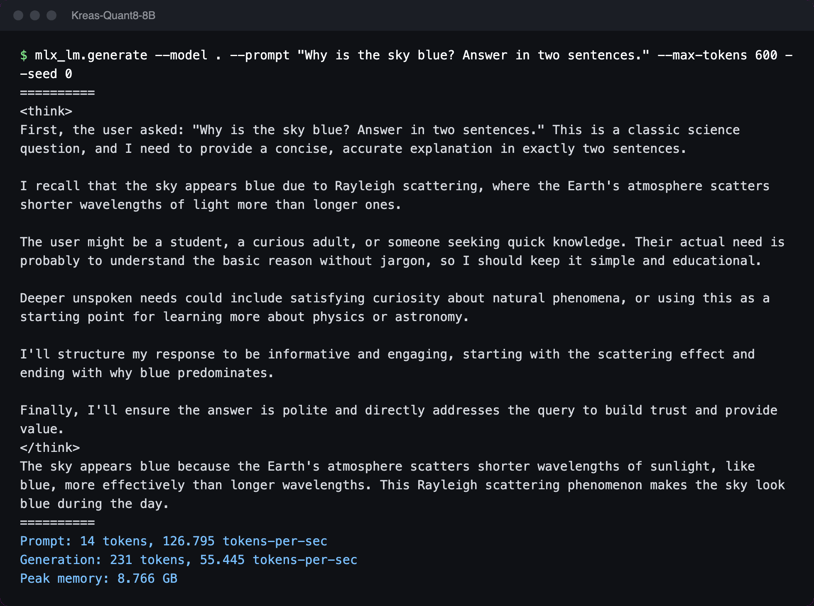

# Kreas

Configuration files for Kreas, an 8.19-billion-parameter language model in MLX format: the Qwen3-8B architecture with weights quantized to 8 bits (group size 64). The weights are 8.7 GB, too big for GitHub, so this repository holds the configuration, the tokenizer settings and the index of the weight files. A clone alone cannot generate text.



*One run on a MacBook Pro (Apple M4 Max, 64 GB) with the weights in place, Nov 14 2026, mlx-lm 0.32.2. The full text is in [sample-run.txt](docs/sample-run.txt).*

## A recorded run

With the two weight shards and `tokenizer.json` in the same folder as these files:

```sh
pip install mlx-lm
mlx_lm.generate --model . --prompt "Why is the sky blue? Answer in two sentences." --max-tokens 600 --seed 0
```

Four runs of this command gave the same text each time:

| Measure | Result |
| --- | --- |
| Generation speed | 54.8 to 55.6 tokens per second |
| Peak memory | 8.77 GB |
| Output | 231 tokens: a `<think>` block, then the answer |

This is one short prompt on one machine. It shows the files load and generate; it is not a benchmark of answer quality.

The model writes its reasoning between `<think>` and `</think>` before the answer. The chat template in `tokenizer_config.json` wraps turns in `<｜User｜>` and `<｜Assistant｜>` and drops the think block from earlier assistant turns.

## Inspect the configuration

```sh
python3 docs/inspect_config.py
```

This reads the committed `config.json` and needs only Python's standard library. Its saved output is in [config-output.txt](docs/config-output.txt).

```text
Architecture: Qwen3ForCausalLM
Layers: 36
Hidden size: 4096
Attention heads: 32
Key/value heads: 8
Position limit: 131072
Quantization: 8 bits
Group size: 64
Weights: not included in this repository
```

## Inspect the weights

```sh
python3 docs/inspect_weights.py /path/to/folder/with/the/shards
```

This reads the JSON header at the start of each `.safetensors` shard, so it also needs only the standard library and never loads the weights into memory. Run without a folder, it summarises the committed `model.safetensors.index.json` instead. Output for the original shards ([weights-output.txt](docs/weights-output.txt)):

```text
model-00001-of-00002.safetensors: 573 tensors, 5.32 GB, format mlx
model-00002-of-00002.safetensors: 334 tensors, 3.38 GB, format mlx
Tensors: 907 (653 BF16, 254 U32)
Quantized layers: 254 at 8 bits
Model parameters: 8,190,735,360 (8.19 billion)
```

The 254 quantized layers are the seven projection matrices in each of the 36 blocks, plus the token embedding and the output head. Each stores its weights as packed 32-bit words with one scale and one bias per group of 64 values. The normalization weights stay in `bfloat16`.

## What the files specify

| Setting | Value |
| --- | --- |
| Model type | `qwen3` |
| Intermediate size | 12,288 |
| Vocabulary size | 151,936 |
| Activation | `silu` |
| Declared tensor dtype | `bfloat16` |
| RoPE scaling | YaRN, factor 4, original limit 32,768 |
| Tied embeddings | No |

The position limit is a configuration value. This repository has no benchmark results validating output quality at that length.

## Files

| File | What it is |
| --- | --- |
| `config.json` | Architecture and quantization settings |
| `tokenizer_config.json` | Special tokens and the chat template |
| `special_tokens_map.json` | Beginning, end and padding tokens |
| `model.safetensors.index.json` | Which shard holds each of the 907 tensors |
| `docs/` | The two inspection scripts, their saved output and the recorded run |

Not included (listed in `.gitignore`): `model-00001-of-00002.safetensors`, `model-00002-of-00002.safetensors` and `tokenizer.json`.

## Load the model

Obtain the matching weight shards and `tokenizer.json` separately, then place them alongside the configuration files. The recorded run above used mlx-lm; other runtimes need to support MLX-format quantized weights. Check the original model's license before distributing the weights.
